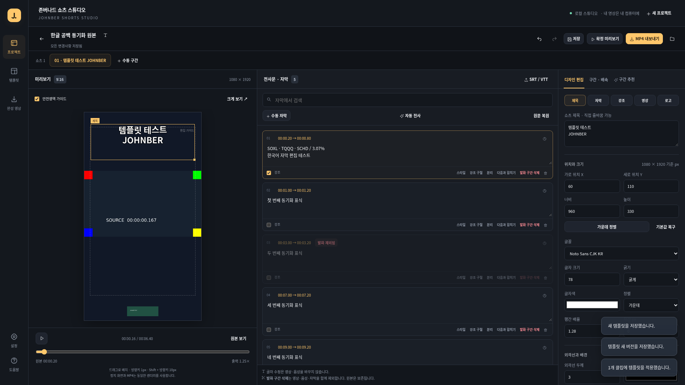

# 존버나드 쇼츠 스튜디오

한국어 강의·PPT·주식·ETF·경제 해설 영상에서 여러 세로 쇼츠를 만드는 개인용 로컬 웹앱입니다. 영상과 SRT 또는 수동 자막, 수동 구간만으로 제목·자막이 들어간 MP4를 출력할 수 있습니다. AI는 선택 기능입니다.

원본 가로 영상을 중앙에 비율을 유지해 넣는 `contain`이 기본입니다. 제목은 위, 자막은 아래에 배치하고 위치와 크기를 바꿀 수 있습니다. 얼굴 중심 자동 크롭을 기본으로 적용하지 않습니다.

이 폴더는 기존 `etf-analyzer-pro`와 분리해 추가했습니다. 기존 Johnber 코드가 없었으므로 FastAPI + 정적 HTML/CSS/JavaScript + Pillow + FFmpeg로 구현했습니다. Node, Docker, Redis, 계정 가입은 필요하지 않습니다. 제공된 TXT 명세를 읽었으며, 별도 `reference_screens/`와 참고 녹화의 실제 화면은 확보하지 못했습니다. ENLIT 자산을 추출하거나 복제하지 않았습니다.

## 프로그램 받기

[Windows 실행용 소스 ZIP 다운로드](https://github.com/sonkanghyuk/etf-analyzer-pro/raw/refs/heads/codex/johnber-shorts-studio/downloads/Johnber_Shorts_Studio.zip)

압축을 풀고 `Johnber_Shorts_Studio` 폴더에서 아래 설치·실행 절차를 진행하세요. ZIP에는 소스와 자체 제작 샘플이 들어 있으며 Python·FFmpeg는 별도로 필요합니다. GitHub 로그인이 필요한 저장소라면 소유 계정으로 로그인한 뒤 다운로드하세요.

다음은 자체 제작 샘플로 실행·검증한 편집 화면입니다. 실시간 웹앱 공유 주소가 아닌 스크린샷입니다.



## 설치와 실행 — Windows

1. [Python 공식 Windows 다운로드](https://www.python.org/downloads/windows/)에서 **Python 3.12**를 설치합니다. 설치 도구는 `py -3.12`를 사용하므로 Python 실행기 `py`가 필요합니다.
2. [FFmpeg 공식 다운로드 안내](https://ffmpeg.org/download.html)에서 안내하는 Windows 배포처의 FFmpeg를 설치합니다. `ffmpeg.exe`와 `ffprobe.exe`가 들어 있는 `bin` 폴더를 사용자 `PATH`에 추가한 뒤 새 명령 프롬프트를 엽니다. 배포처가 제공하는 서명 또는 체크섬을 확인하고, TLS·패키지 검증을 끄지 마세요. 앱은 시스템 프로그램을 관리자 권한으로 자동 설치하지 않습니다.
3. 이 폴더의 `설치.cmd`를 실행합니다. 프로젝트 전용 `.venv`를 만들고 `requirements.lock`의 고정 버전을 설치합니다.
4. `실행.cmd`를 실행하고 브라우저에서 **http://127.0.0.1:8765**를 엽니다. 종료할 때 실행 창에서 `Ctrl+C`를 누릅니다.

명령 프롬프트에서 직접 실행할 수도 있습니다.

```bat
cd /d C:\작업폴더\johnber-shorts-studio
py -3.12 -m venv .venv
.venv\Scripts\python.exe -m pip install -r requirements.lock
ffmpeg -version
ffprobe -version
.venv\Scripts\python.exe run.py
```

Python·FFmpeg를 설치한 뒤에도 기존에 열어 둔 명령 프롬프트에는 변경한 `PATH`가 반영되지 않을 수 있습니다. 새 창에서 확인하세요. 이 구현의 Windows 실행 도구는 제공하지만 Windows 실기 검증은 아직 수행하지 않았습니다.

포함된 샘플로 먼저 확인하려면 `samples/demo-source.mp4`를 새 프로젝트로 업로드하고 `samples/demo-project.json`을 **프로젝트 열기**로 가져오세요. 원본을 먼저 등록해야 JSON의 동일 해시 원본을 찾을 수 있습니다. 처음부터 편집하려면 영상 등록 뒤 `samples/demo-subtitles.srt`를 불러옵니다. 이미 생성된 실제 결과는 `samples/demo-export.mp4`입니다. 샘플 음성은 동기화 검사용 합성음이며 실제 한국어 강의나 ASR 검증 자료가 아닙니다.

## 설치와 실행 — Linux

Python 3.12와 FFmpeg/ffprobe, 한글 글꼴이 설치된 환경을 사용합니다. 시스템 패키지는 운영체제의 서명 검증을 사용하는 공식 패키지 관리자로 준비하세요. 이 저장소는 글꼴 파일을 포함하지 않습니다.

```bash
cd /path/to/etf-analyzer-pro/johnber-shorts-studio
python3.12 -m venv .venv
.venv/bin/python -m pip install -r requirements.lock
ffmpeg -version
ffprobe -version
.venv/bin/python run.py
```

기본 바인딩은 `127.0.0.1`입니다. 공개 서버 배포나 계정 게시 기능은 포함하지 않습니다. Linux 검증 환경은 Python 3.12, FFmpeg 7.1, Noto CJK를 사용합니다. 실제 실행한 검증 결과와 남은 항목은 [PROGRESS.md](PROGRESS.md)에 기록합니다.

## 첫 MP4 만들기 — API 키 없이

1. 프로젝트 화면에서 실제 MP4를 업로드합니다. MOV/MKV/WEBM/M4V도 실제 디코딩과 길이 검사에 성공해야 등록됩니다. UI 참고 녹화는 제작 원본으로 사용하지 마세요.
2. SRT/VTT를 불러오거나 자막을 직접 추가합니다. 자막의 시작·끝은 **원본 시각(초)**입니다. 겹친 시간, 빈 문장, 역전·범위 초과는 수정해야 저장됩니다.
3. 클립의 시작·끝과 제목을 정합니다. 제목, 일반 자막, 강조 자막, 영상, 텍스트 로고의 위치·크기·스타일을 바꿉니다. 좌표는 1080×1920 기준이며 숫자로 조정하거나 미리보기에서 드래그합니다.
4. 변경을 저장하고 서버에서 만든 확정 프레임/영상 미리보기를 확인합니다. 드래그 중 표시되는 조작 안내만으로 출력 결과를 판단하지 말고 확정 미리보기를 확인하세요.
5. 원하는 클립을 선택해 내보냅니다. 완료한 실제 파일에서 MP4를 받습니다. 여러 클립을 출력하면 개별 MP4와 ZIP을 받습니다. SRT와 제목·자막 텍스트도 별도로 저장됩니다.

일반 SRT는 텍스트와 시간만 담습니다. 글꼴·색·배경 등 스타일 복원에는 프로젝트 JSON 또는 템플릿 JSON이 필요합니다. 기본 출력은 **H.264/AAC, 1080×1920, 30fps, yuv420p, faststart**입니다. 음성 트랙이 있는 원본은 AAC로 출력하고 음성 없는 원본은 무음 영상으로 출력합니다.

## 편집과 템플릿

- **자막 문장 수정**은 표시되는 글만 바꿉니다. 원본 발화와 영상은 삭제하지 않습니다. **발화 구간 삭제**는 EDL에 원본 시각 범위를 추가하여 영상·음성·자막을 함께 제외합니다.
- 배속은 기본 1배이며 편집 화면에서 0.75~2배를 선택합니다(API 저장 범위 0.5~2배). 무음 감지는 삭제 후보를 먼저 제안합니다. 적용 전에 숫자·단어의 첫음절·끝음절·문맥을 확인하세요.
- 자막 분리의 기본 시간은 선택한 글자 위치의 비율로 나눕니다. 단어별 강제 정렬이 아니므로 분리 후 자막 시각을 원음에 맞게 확인·수정하세요.
- 제목·일반 자막·강조 자막은 글꼴 계열, 크기, 색, 외곽선, 배경 등을 조정합니다. 강조 단어는 원문에서 일치하는 문자열에 적용되며 위치와 줄바꿈은 일반 자막의 배치를 따릅니다.
- 자막 스타일은 클립 전체 또는 선택한 원문 문장에 적용할 수 있습니다. **문장별 스타일은 프로젝트의 해당 전사 문장에 저장되므로 같은 문장을 사용하는 다른 클립에도 반영됩니다.** 클립마다 독립적인 전체 디자인은 클립 범위로 수정하세요.
- 기본 템플릿은 강의 보존형·자료 가독형·미니멀 강의형의 3종입니다. 사용자 템플릿을 저장·복제하고 JSON으로 내보내거나 불러올 수 있습니다. 적용한 스타일 사본과 템플릿 버전을 클립에 보존합니다. 템플릿 원본 수정이 기존 클립을 자동 변경하지 않습니다.
- 같은 프로젝트의 여러 클립에 템플릿을 적용할 수 있습니다. 적용 화면의 수정 유지/덮어쓰기 범위를 확인하세요.
- 실행 취소/다시 실행은 현재 편집 세션의 기록을 사용합니다. 새로고침 이후까지 무제한 되돌리기를 보장하지 않습니다. 서버에 저장할 때 별도 이전 프로젝트 스냅샷도 남습니다.

편집 중 `Ctrl+S`로 저장, `Ctrl+Z`로 실행 취소, `Ctrl+Shift+Z`로 다시 실행합니다. 캔버스에서 선택한 요소는 방향키로 1px, `Shift+방향키`로 10px 이동합니다. 글자 입력 중 `Ctrl+Z`와 방향키는 입력칸의 기본 동작을 사용합니다.

미리보기와 MP4는 같은 Pillow 텍스트 레이어, 글꼴·줄바꿈·좌표와 EDL을 사용합니다. 정확한 시간 변환과 프레임 반올림은 [docs/TIMELINE.md](docs/TIMELINE.md)를 참고하세요.

## 저장 위치와 백업

기본 데이터 폴더는 이 프로젝트의 **`.local/data/`**입니다.

| 경로 | 내용 |
| --- | --- |
| `sources/<SHA256>.media` | 업로드한 원본 사본. 원본 바이트를 해시로 구분하고 편집하지 않음 |
| `projects/<ID>.json` | 저장 프로젝트, 자막, 클립, 편집 결정과 스타일 |
| `history/<프로젝트ID>/<리비전>.json` | 저장 전의 프로젝트 스냅샷 |
| `templates/`, `template_history/` | 사용자 템플릿과 이전 버전 |
| `assets/`, `image_assets/` | 사용자 등록 로고·배경의 PNG 사본과 출처 메타데이터 |
| `cache/` | 전사·추천 캐시, 선택적으로 내려받은 로컬 모델 |
| `jobs/` | 작업의 입력 스냅샷, 상태·오류·결과 |
| `artifacts/`, `outputs/<작업ID>/` | 출력 메타데이터와 실제 MP4/SRT/TXT/ZIP |
| `trash/` | 삭제한 프로젝트 문서 보관본 |
| `work/`, `tmp/` | 작업 임시 파일 |

프로젝트 삭제는 원본 사본을 지우지 않습니다. 업로드 전 사용자 PC의 원본 파일도 수정하거나 삭제하지 않습니다. 데이터 폴더를 직접 지우면 앱이 보존한 원본·완성본·작업 기록도 사라지므로 먼저 백업하세요. 백업할 때는 앱을 종료한 뒤 `.local/data/` 전체를 복사하는 방법이 가장 단순합니다.

프로젝트 JSON에는 **영상과 이미지 파일이 포함되지 않습니다**. 다른 컴퓨터에서 다시 열려면 동일한 원본 파일을 먼저 업로드한 뒤 JSON을 가져와야 합니다. 파일 이름이 같아도 바이트/해시가 다르면 같은 원본으로 인식하지 않습니다. 로고·배경 이미지도 다시 등록하거나 전체 데이터 폴더로 함께 옮겨야 합니다. 이전 스냅샷을 복원하려면 해당 JSON을 프로젝트 가져오기로 불러와 사본으로 연 뒤 내용을 확인하세요. 현재 프로젝트를 강제로 덮어쓰는 방식은 아닙니다.

## 선택적 자동 전사·AI 추천

키가 없어도 업로드, SRT/수동 자막, 수동 구간, 템플릿 편집과 MP4 출력은 사용할 수 있습니다. 규칙 기반 후보는 **AI 결과가 아닌 문장·길이 기반 후보**로 표시합니다. 점수는 내부 평가이며 조회수나 수익 확률을 뜻하지 않습니다.

설정이 필요하면 `.env.example`을 `.env`로 복사하고 서버를 재시작하세요. 키 값은 로컬 `.env` 또는 서버 환경변수에만 넣고 화면, 프로젝트 JSON, Git, 이슈에 공유하지 마세요. `run.py`는 `.env`의 `JOHNBER_`로 시작하는 항목만 읽고, 이미 설정된 환경변수를 덮어쓰지 않습니다.

| 변수 | 기본값 / 의미 |
| --- | --- |
| `JOHNBER_PORT` | `8765`, 로컬 포트 |
| `JOHNBER_MAX_UPLOAD_MB` | `4096`, 업로드 제한. 실측 성능 보장이 아님 |
| `JOHNBER_MAX_DURATION_SECONDS` | `14400`, 원본 길이 제한. 실측 성능 보장이 아님 |
| `JOHNBER_DATA_DIR` | 생략하면 `.local/data`; 변경 전 기존 데이터를 백업·이동할 것 |
| `JOHNBER_LOCAL_MODEL` | `small`, 로컬 faster-whisper 모델 |
| `JOHNBER_API_KEY` | 선택적 외부 제공자 키 |
| `JOHNBER_API_BASE` | `https://api.openai.com/v1`, 호환 API 기본 URL |
| `JOHNBER_STT_MODEL` | `whisper-1`, 문장 시간정보/verbose_json 지원이 필요한 외부 전사 모델 |
| `JOHNBER_CHAT_MODEL` | `gpt-4.1-mini`, JSON 응답을 사용하는 외부 추천 모델 |

**로컬 전사**를 사용하려면 선택적 패키지를 따로 설치합니다.

```bat
.venv\Scripts\python.exe -m pip install -r requirements-ai.txt
```

Linux에서는 `.venv/bin/python -m pip install -r requirements-ai.txt`를 사용합니다. 최초 모델 다운로드는 앱에서 별도로 동의해야 합니다. 모델이 없고 다운로드에 동의하지 않으면 구체적인 오류를 표시합니다. 로컬 모델은 CPU/int8로 실행하며 GPU를 필수로 요구하지 않습니다. 외부 API 요금은 없지만 모델 다운로드, 디스크, 메모리와 처리 시간이 필요합니다. 사전은 인식 보조 프롬프트이며 숫자·고유명사를 강제로 치환하지 않습니다.

**외부 전사**는 원본에서 로컬로 추출한 16kHz 모노 음성을 조각으로 전송합니다. **외부 추천**은 시간정보가 있는 전사문을 전송합니다. 기본적으로 원본 영상 전체를 제3자에게 업로드하지 않습니다. 각 외부 작업 전에 전송·비용 동의가 필요합니다. 실제 요금과 계정 권한은 제공자 요금표를 확인해야 하며 앱은 **비용 미확인**으로 표시합니다. 취소 전 제공자가 이미 받은 요청은 과금될 수 있습니다. 구현된 모델 식별자와 사용자 계정에서 실제 사용할 수 있는 모델은 다를 수 있습니다.

전사 캐시는 원본 해시·제공자·모델·언어·사전·구현 버전으로 구분합니다. 추천 캐시는 전사 ID/텍스트/시간·제공자·모델·요청 길이·개수·구현 버전으로 구분합니다. 외부 제공자 주소도 캐시에 포함됩니다. 색이나 템플릿 변경은 AI 분석을 자동 재실행하지 않습니다. 전사 수정은 추천 입력을 바꾸므로 새 분석이 필요할 수 있습니다. 외부 호출 실패를 가짜 결과로 대체하지 않습니다.

**실제 한국어 음성의 로컬 ASR 및 인증된 외부 AI 제공자 연결은 아직 검증하지 않았습니다.** 어댑터·캐시·오류 검증과 실제 모델 품질/제공자 연결 검증을 구분합니다.

## 글꼴과 자산

Windows에서는 설치된 맑은 고딕/바탕 계열을, Linux에서는 설치된 Noto Sans/Serif CJK를 사용합니다. 글꼴은 시스템에서 읽으며 폰트 파일을 재배포하지 않습니다. 시스템에 한글 글꼴이 없으면 경고가 표시되고 글자가 누락될 수 있습니다. 다른 운영체제의 글꼴 차이로 화면 배치가 달라질 수 있으므로, 최종 제작 컴퓨터에서 확정 미리보기를 확인하세요.

참고 서비스의 브랜드·로고·템플릿 배경·폰트 파일은 포함하지 않습니다. 텍스트 로고와 사용자 제공 PNG/JPEG/WEBP 로고·배경 이미지를 등록할 수 있습니다. 이미지는 최대 20MB·1600만 픽셀로 제한하고 로컬 PNG 사본으로 정규화합니다. 로고는 비율을 유지하며 지정한 상자에 넣습니다. 사용할 권한이 있는 이미지만 등록하고 출처·허용 조건은 사용자가 확인해야 합니다. 음악, 애니메이션, 모자이크, YouTube 가져오기, 플랫폼 게시·예약은 제공하지 않습니다.

## 작업 상태와 문제 해결

작업 큐는 로컬 CPU 부하를 줄이기 위해 한 번에 한 작업을 처리합니다. 대기·실행·성공·실패·취소·서버 재시작으로 중단된 상태를 저장합니다. 렌더 진행률은 FFmpeg의 실제 출력 시각을 사용하고, 측정할 수 없는 단계는 단계명으로 표시합니다. 서버 재시작으로 실행 중이던 작업은 `interrupted`로 정리하며 재시도할 수 있습니다. 작업은 시작할 때의 프로젝트 스냅샷을 사용합니다.

| 증상 | 확인할 항목 |
| --- | --- |
| Python 또는 `py -3.12`가 없음 | Python 3.12와 Python 실행기 설치, 새 명령 프롬프트에서 확인 |
| FFmpeg/ffprobe 없음 | `ffmpeg -version`, `ffprobe -version`, FFmpeg `bin`의 `PATH` 등록 |
| 8765 포트 사용 중 | 기존 앱 종료 또는 `.env`에서 `JOHNBER_PORT` 변경 후 재시작 |
| 프로젝트 JSON의 원본 없음 | 동일한 원본 파일을 먼저 업로드; JSON은 영상 미포함 |
| 다른 창이 프로젝트를 변경함 | 프로젝트를 다시 열어 최신 저장본 확인; 덮어쓰기 충돌을 방지하는 동작 |
| 손상 영상·자막 시간 오류 | 실제 미디어인지, 자막 겹침/빈 문장/원본 범위를 확인 |
| 로컬 모델 없음 | 선택 패키지와 모델 캐시·다운로드 동의·디스크·네트워크 확인 |
| API 인증/한도/네트워크 오류 | 서버의 키·모델 권한·사용량 한도·HTTPS/네트워크 정책 확인 |
| 저장 공간 부족·출력 실패 | 데이터 폴더 디스크 여유 확인 후 재시도; 직전 성공본을 먼저 보존 |

취소는 해당 작업의 FFmpeg 프로세스와 처리 단계를 중단하도록 요청합니다. 외부 응답이나 로컬 모델 로딩처럼 라이브러리 내부에 진입한 단계는 즉시 취소되지 않을 수 있습니다. 마지막 성공 파일은 새 출력의 검사에 성공하기 전까지 보존합니다. 상세 오류는 앱의 작업 목록과 서버 실행 창에서 확인합니다. `.env`나 키가 포함된 로그를 공유하지 마세요.

## 테스트와 업데이트

인수 기준 A01–A17의 실행 범위와 수치는 [docs/ACCEPTANCE_RESULTS.md](docs/ACCEPTANCE_RESULTS.md), 다음 세션 인계는 [PROGRESS.md](PROGRESS.md), 시간 계산 규칙은 [docs/TIMELINE.md](docs/TIMELINE.md)에 남깁니다. Windows 미검증과 실제 AI 연결 미검증을 로컬 제작 경로의 성공과 구분합니다.

개발 검증에는 선택적 테스트 의존성을 설치합니다. 아래 Linux 명령에서 Windows는 `.venv/bin/python`을 `.venv\Scripts\python.exe`로 바꾸면 됩니다.

```bash
.venv/bin/python -m pip install -r requirements-test.lock
.venv/bin/python -m unittest discover -s tests -v
```

통합 테스트는 FFmpeg로 자체 제작 테스트 영상을 만들고 실제 1080×1920 MP4 여러 개를 인코딩합니다. 외부 AI API나 사용자 원본을 사용하지 않지만 CPU·디스크와 수 분의 시간이 필요합니다. 테스트 데이터는 `.local/sample-input/`, `.local/acceptance-data/`, 결과는 `.local/sample-output/`에 생성합니다. 검증용 프로젝트를 앱에서 열려면 `.local/sample-input/한글 공백 동기화 원본.mp4`를 먼저 업로드한 뒤 `.local/sample-output/sample-project.json`을 가져오세요. 수동 자막은 `.local/sample-input/수동 테스트 자막.srt`입니다.

Linux/macOS의 실제 프로세스 복구 검사는 기본 실행에서 건너뜁니다. 개발자가 별도로 실행하려면 `JOHNBER_LIVE_TESTS=1 .venv/bin/python -m unittest tests.test_live_recovery -v`를 사용합니다. 이 테스트는 **자신이 시작한 별도 로컬 서버 프로세스 그룹만** 강제 종료·재시작하고 실제 MP4 재시도를 확인합니다. Windows 실기 복구 검사를 대신하지 않습니다.

Playwright는 개발용 브라우저 검증에만 필요합니다. 일반 사용자는 브라우저 자동화나 테스트 패키지를 설치할 필요가 없습니다. Linux 검증은 기존 `/usr/bin/chromium`을 사용합니다. 개발자가 자신의 컴퓨터에서 브라우저 자동화를 추가 실행하려면 `python -m playwright install chromium`으로 테스트용 Chromium을 준비할 수 있습니다. 이 다운로드는 앱 실행의 필수 단계가 아닙니다.

업데이트 전 앱을 종료하고 코드와 데이터 폴더를 백업하세요. 코드를 업데이트한 뒤 같은 가상환경에서 `python -m pip install -r requirements.lock`을 다시 실행합니다. `.env`와 `.local/data/`를 덮어쓰지 마세요. 현재 프로젝트 스키마는 버전 1이며, 다른 버전의 JSON은 조용히 변환하지 않고 거부합니다.
